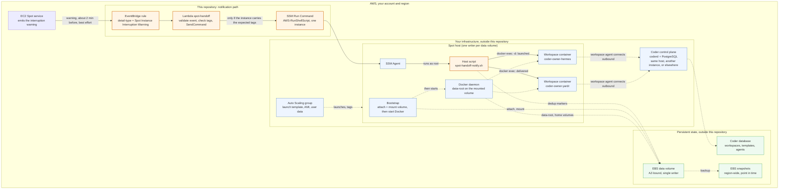

# Architecture: agent workspaces on a Spot host

Three layers, two of which you supply. This page draws the whole picture
once so that every other page can point at one part of it. The assembly
guide is [`setup.md`](setup.md); the notifier's own behaviour, deployment
and testing are in the [top-level README](../README.md).

- **Infrastructure** (yours): a Coder control plane, wherever it runs, and
  a Spot host launched by an Auto Scaling group from a launch template,
  carrying Docker, the SSM Agent, the expected tags and the workspace
  containers.
- **Persistent state** (yours): a durable data volume mounted before Docker
  starts, so that Docker's data root, the workspace home volumes, the
  agents' own session and task records and the notifier's dedup markers
  all outlive the instance; snapshots of it; and the Coder database, which
  belongs to the control plane.
- **Notification path** (this repository): EventBridge rule, Lambda, SSM
  Run Command, the host script, one `docker exec` per target. It tells the
  agents that the host is about to go. It does not launch, mount, replace
  or resume anything.

## Diagram

Solid arrows are the Spot interruption notification, the only thing this
repository implements. Dotted arrows are relationships your infrastructure
and bootstrap establish on their own.

## Who does what

| Piece | Supplied by | Responsibility | Where it is described |
| --- | --- | --- | --- |
| EventBridge rule, Lambda, IAM, log group | this repository | Turn one Spot warning into one SSM command to the affected, tagged instance | README: *How it behaves*, *IAM*; `terraform/`, `cloudformation/` |
| Host script | this repository (shipped inside the Lambda zip) | Run every configured target in parallel inside its container, dedup per event, report per target | README: *On the host*, *Operations* |
| Target commands | you, as configuration | What each agent is told; the examples carry the Hermes recovery-note oneshot and the yardr mail | README: *Configuration*; `examples/basic/` |
| Coder control plane | you | Templates, workspace lifecycle, agent registration; it can run on the Spot host, on a separate instance, or as a managed service | `setup.md`, *Coder control plane* |
| Auto Scaling group, launch template, AMI, bootstrap | you | Launch a replacement Spot host with the same tags, instance role and boot order | `setup.md`, *Workspace host* |
| Data volume, snapshots | you | Keep Docker's data root, the workspace homes and the agents' records across instances; one writer at a time | `setup.md`, *Durable storage* |
| Resuming work | the agents' own schedulers and runners | Read the handoff note and the persisted records, pick the work up again | README: *Limits and non-goals* |

Nothing in this repository creates, attaches, mounts, snapshots or
replaces anything in the two lower rows of the diagram. There is no Auto
Scaling automation, no storage automation and no resume mechanism here,
and the setup guide describes those pieces so you can build them to your
needs, not because they ship.

## The interruption, in order

1. EC2 decides to reclaim the instance and emits the warning about two
   minutes before, on a best-effort basis; the same warning is visible in
   the instance metadata (`spot/instance-action`). A rebalance
   recommendation may arrive earlier, or at the same moment
  ([Spot Instance interruption notices](https://docs.aws.amazon.com/AWSEC2/latest/UserGuide/spot-instance-termination-notices.html),
  [rebalance recommendations](https://docs.aws.amazon.com/AWSEC2/latest/UserGuide/rebalance-recommendations.html)).
2. The notification path runs: rule, Lambda, `SendCommand`, host script,
   `docker exec`. Each hop eats into the window; the README's *Validation
   status* has the one owner-reported timing.
3. The agents react inside their containers: Hermes writes its recovery
   note to its handoffs directory, yardr mails the yardmaster. Both write
   to storage that is on the mounted data volume, which is why that volume
   has to outlive the instance.
4. The instance terminates. A lifecycle hook on the Auto Scaling group
   cannot hold it: "a lifecycle hook does not prevent an instance from
   terminating in the event that capacity is no longer available"
   ([lifecycle hooks](https://docs.aws.amazon.com/autoscaling/ec2/userguide/lifecycle-hooks.html)).
   The data volume survives if its `DeleteOnTermination` is `false`
   ([preserve data when an instance is terminated](https://docs.aws.amazon.com/AWSEC2/latest/UserGuide/preserving-volumes-on-termination.html)).
5. The Auto Scaling group launches a replacement; your bootstrap attaches
   and mounts the volume, starts Docker, starts the containers; the
   workspace agents reconnect to the control plane. All of this is yours
   (`setup.md`, *Boot order*).
6. Whatever already schedules and runs the agents' work reads the handoff
   note and the persisted records and continues. The notifier adds nothing
   here, by design.

## Topologies

The notifier only needs the workspace containers, Docker and the SSM Agent
on the tagged Spot host. Where the Coder control plane runs is independent:

- **On the Spot host too**, as a container next to the workspaces. Simplest;
  the control plane is interrupted with the host, and its database must be
  on the data volume or external. The notifier refuses to target the control
  server container (`forbidden_containers`, default `coder`).
- **On a separate On-Demand instance** in the same VPC, reaching the Spot
  host's Docker daemon over the network or through an SSH-based Docker
  context, and reached by the workspace agents at the access URL.
- **Managed elsewhere** (another account, region or provider), with only the
  Docker provider's host and the agents' outbound connection crossing the
  boundary.

The setup guide spells out what each option changes. Do not read any one of
them as mandatory.
